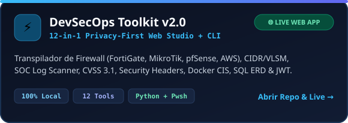
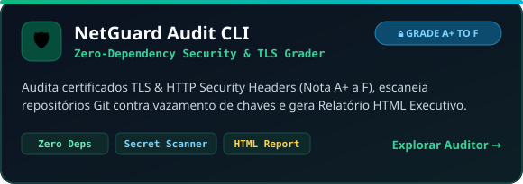
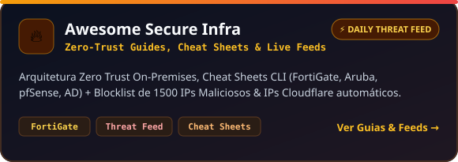
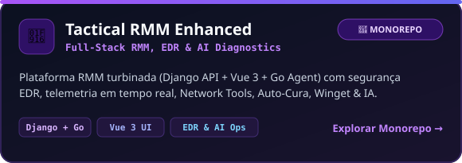

<div align="center">

<!-- Custom Animated Cyber/DevSecOps Hero Banner (Local SVG — 100% Uptime, Crisp on Dark & Light Mode) -->
<a href="https://wallisonws.github.io/devsecops-toolkit/">
  
</a>

<br/>

<!-- Live Social Proof & High-Impact CTAs -->
<p align="center">
  <a href="https://wallisonws.github.io/devsecops-toolkit/"></a>
  <a href="https://wallisonws.github.io/netguard-audit/"></a>
  <a href="https://linkedin.com/in/wallisonaraujo"></a>
  <a href="mailto:wallisonoficial85@gmail.com"></a>
</p>

<p align="center">
  
  
  
  
</p>

</div>

---

## 🚀 Flagship Open-Source Tools & Live Production Apps

> **Built for Developers, Security/SOC Analysts, Data Engineers & SysAdmins — 100% Open Source & Privacy-First.**

<table>
  <tr>
    <td width="50%" align="center">
      <a href="https://github.com/WallisonWS/devsecops-toolkit">
        
      </a>
      <br/>
      <a href="https://wallisonws.github.io/devsecops-toolkit/">🌐 <b>Live Web Studio (12 Tools)</b></a> • <a href="https://github.com/WallisonWS/devsecops-toolkit">📦 Source &amp; CLI</a>
    </td>
    <td width="50%" align="center">
      <a href="https://github.com/WallisonWS/netguard-audit">
        
      </a>
      <br/>
      <a href="https://wallisonws.github.io/netguard-audit/">🌐 <b>Live Secret Scanner</b></a> • <a href="https://github.com/WallisonWS/netguard-audit">📦 Python &amp; PowerShell CLI</a>
    </td>
  </tr>
  <tr>
    <td width="50%" align="center">
      <a href="https://github.com/WallisonWS/awesome-secure-infrastructure">
        
      </a>
      <br/>
      <a href="https://github.com/WallisonWS/awesome-secure-infrastructure">🛡️ <b>Zero-Trust Guides &amp; Automated Threat Feeds</b></a>
    </td>
    <td width="50%" align="center">
      <a href="https://github.com/WallisonWS/tactical-rmm-enhanced">
        
      </a>
      <br/>
      <a href="https://github.com/WallisonWS/tactical-rmm-enhanced">🤖 <b>Full-Stack RMM + EDR + AI Diagnostics Monorepo</b></a>
    </td>
  </tr>
</table>

---

## 👨‍💻 Engineering Profile & Impact

I am a **hybrid Software Engineer & Cybersecurity / Network Architect** bridging modern **Full-Stack & Mobile Engineering** with **Enterprise Zero-Trust Infrastructure**. I build resilient systems from the network packet layer up to the user interface.

| 💻 Software Engineering & Automation | 🛡️ Cybersecurity, Cloud & Infrastructure |
| :--- | :--- |
| • **Web & Mobile Apps:** React, Next.js, TypeScript, Flutter & Dart | • **Zero-Trust Networks:** FortiGate 80F, pfSense, MikroTik, Aruba & UniFi |
| • **Backend & Systems:** Python, Go, Django, REST APIs, SQL & Docker | • **Security Engineering:** VLAN Isolation, Threat Intel Feeds, EDR & AppSec |
| • **DevEx & Open Source:** Privacy-first browser tools & zero-dependency CLIs | • **Enterprise Ops:** Linux SysAdmin, Windows Server, AD, XCP-ng & VoIP |

---

## 🛠️ Technology Stack & Security Arsenal

<div align="center">

**Languages & Application Frameworks**


**DevSecOps, Networking & Enterprise Infrastructure**


</div>

---

## 📊 GitHub Activity & Contribution Graph

<div align="center">
  <!-- Automated GitHub Contribution Snake (updated every 12h via GitHub Actions) -->
  <picture>
    <source media="(prefers-color-scheme: dark)" srcset="https://raw.githubusercontent.com/WallisonWS/WallisonWS/output/github-contribution-grid-snake-dark.svg">
    <source media="(prefers-color-scheme: light)" srcset="https://raw.githubusercontent.com/WallisonWS/WallisonWS/output/github-contribution-grid-snake.svg">
    
  </picture>
</div>

<br/>

<details>
  <summary><b>🏛️ Enterprise Operations, Institutional Systems &amp; GTD Metrics (Click to expand)</b></summary>

  <br/>

  **Corporate Infrastructure & Integrated Management Systems (ABC Associação Brasil Central):**
  * **Zero-Trust Segmentation & CFTV Isolation:** FortiGate 80F, Aruba Switches, UniFi Wireless, NXFilter, Hikvision NVR & Asterisk VoIP.
  * **Virtualization & Directory:** XCP-ng, Windows Server, Active Directory & Monit.
  * **Mission-Critical ERP Administration:** CPB / E-CLASS, SAD, SSE, AASI & CFE, APS, Urania & Sino.

<!-- TRELLO_STATS_START -->
#### 📊 Trello & Kanban - Metricas de Produtividade GTD
```text
Progresso de Tarefas: [██████████████████░░] 90%
--------------------------------------------------
📋 A Fazer (To Do):     3
⚙️ Em Andamento (Doing): 2
✅ Concluidos (Done):    45
```
_💡 **Modo de Demonstracao** | Para ativar a sincronizacao real com o seu Trello, adicione as Secrets no repositorio (`TRELLO_API_KEY`, `TRELLO_TOKEN`, `TRELLO_BOARD_ID`)._
<!-- TRELLO_STATS_END -->

</details>

---

<div align="center">

### ⭐ Support Open-Source DevSecOps Tooling
If any of my tools saved you time in development, incident response, or infrastructure hardening, consider **following [`@WallisonWS`](https://github.com/WallisonWS)** and dropping a **⭐ Star** on the repositories!

<a href="https://linkedin.com/in/wallisonaraujo"></a>
&nbsp;&nbsp;
<a href="mailto:wallisonoficial85@gmail.com"></a>
&nbsp;&nbsp;
<a href="https://wallisonws.github.io/devsecops-toolkit/"></a>

</div>
