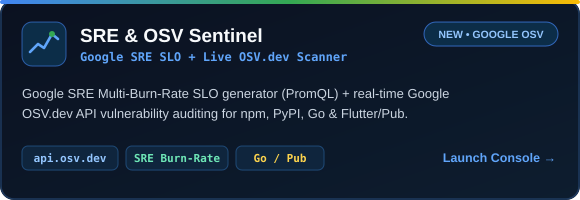

  
  
  
  
  
  

---

## 🚀 Flagship Open-Source Engineering Suite

<table>
  <tr>
    <td width="50%" align="center">
      
       
      <a href="https://wallisonws.github.io/aegis-llm-guard/"><b>Live Playground</b></a> &nbsp;•&nbsp; <a href="https://github.com/WallisonWS/aegis-llm-guard"><b>Python &amp; JS SDK</b></a>
    </td>
    <td width="50%" align="center">
      
       
      <a href="https://wallisonws.github.io/sre-osv-sentinel/"><b>Live OSV.dev &amp; SLO Console</b></a> &nbsp;•&nbsp; <a href="https://github.com/WallisonWS/sre-osv-sentinel"><b>Zero-Dep CLI</b></a>
    </td>
  </tr>
  <tr>
    <td width="50%" align="center">
      
       
      <a href="https://wallisonws.github.io/devsecops-toolkit/"><b>Live 12-in-1 Web Studio</b></a> &nbsp;•&nbsp; <a href="https://github.com/WallisonWS/devsecops-toolkit"><b>CLI &amp; Tests</b></a>
    </td>
    <td width="50%" align="center">
      
       
      <a href="https://wallisonws.github.io/netguard-audit/"><b>Live Secret Scanner</b></a> &nbsp;•&nbsp; <a href="https://github.com/WallisonWS/netguard-audit"><b>Python &amp; Pwsh CLI</b></a>
    </td>
  </tr>
</table>

---

## 🧩 Complete Open-Source Directory (17 Live Web Apps + CLIs)

### 🛡️ AI Security & Blue-Team Cyber-Defense
| Project | Focus Area | Live App |
| :--- | :--- | :--- |
| **[aegis-llm-guard](https://github.com/WallisonWS/aegis-llm-guard)** | OWASP LLM Top 10 prompt-injection firewall & reversible PII vault for Gemini / Vertex AI / MCP. | [Launch →](https://wallisonws.github.io/aegis-llm-guard/) |
| **[mcp-sentinel-firewall](https://github.com/WallisonWS/mcp-sentinel-firewall)** | Zero-Trust MCP server auditor: detects Tool-Poisoning, Rug-Pull SHA-256 drift & Cloud SSRF. | [Launch →](https://wallisonws.github.io/mcp-sentinel-firewall/) |
| **[rag-poison-guard](https://github.com/WallisonWS/rag-poison-guard)** | Defends Vector DBs & RAG pipelines against Unicode Tag Smuggling, BiDi Trojans & Markdown exfil. | [Launch →](https://wallisonws.github.io/rag-poison-guard/) |
| **[ai-code-sec-scanner](https://github.com/WallisonWS/ai-code-sec-scanner)** | Zero-dependency SAST catching SQLi, Command Injection, `pickle`/`eval` RCE & XSS in LLM code. | [Launch →](https://wallisonws.github.io/ai-code-sec-scanner/) |
| **[slopsquat-guard](https://github.com/WallisonWS/slopsquat-guard)** | Defends against AI package hallucination (*Slopsquatting*), typosquatting & malicious `postinstall` hooks. | [Launch →](https://wallisonws.github.io/slopsquat-guard/) |
| **[deepfake-phish-shield](https://github.com/WallisonWS/deepfake-phish-shield)** | IDN/Punycode homograph spoofing, brand typosquatting, SPF/DKIM/DMARC audit & strict DNS builder. | [Launch →](https://wallisonws.github.io/deepfake-phish-shield/) |
| **[ai-bot-defense](https://github.com/WallisonWS/ai-bot-defense)** | Honeypot Traps, Adaptive Rate Limiters & WAF/Nginx/Fail2Ban/FastAPI/Express rules vs AI fuzzers. | [Launch →](https://wallisonws.github.io/ai-bot-defense/) |

### ☁️ Cloud-Native SRE, DevSecOps & Zero-Trust Infrastructure
| Project | Focus Area | Live App / Repo |
| :--- | :--- | :--- |
| **[sre-osv-sentinel](https://github.com/WallisonWS/sre-osv-sentinel)** | Google SRE Multi-Burn-Rate SLO alerts (`PromQL`) + live Google `api.osv.dev` CVE scanner. | [Launch →](https://wallisonws.github.io/sre-osv-sentinel/) |
| **[k8s-zero-trust-lab](https://github.com/WallisonWS/k8s-zero-trust-lab)** | Kubernetes `NetworkPolicy` generator & CIS Pod Security Standards YAML auditor (GKE/EKS/AKS). | [Launch →](https://wallisonws.github.io/k8s-zero-trust-lab/) |
| **[devsecops-toolkit](https://github.com/WallisonWS/devsecops-toolkit)** | **16-in-1 Bilingual (EN/PT-BR)** workbench: Firewall Transpiler, CIDR, SOC, CVSS 3.1, AI Token/Cost, Git Rescue, TLS 1.3 & Brazil CPF/CNPJ/PIX EMV. | [Launch →](https://wallisonws.github.io/devsecops-toolkit/) |
| **[netguard-audit](https://github.com/WallisonWS/netguard-audit)** | Zero-dependency TLS & HTTP Security Headers grader (`A+` to `F`), Git secret audit & HTML reports. | [Launch →](https://wallisonws.github.io/netguard-audit/) |
| **[zero-leak-env](https://github.com/WallisonWS/zero-leak-env)** | `.env` entropy auditor & converter to `.env.example`, Base64 K8s `Secret` YAML & `gh secret set`. | [Launch →](https://wallisonws.github.io/zero-leak-env/) |
| **[awesome-secure-infrastructure](https://github.com/WallisonWS/awesome-secure-infrastructure)** | Zero-Trust network blueprints, CLI cheat sheets & automated daily Threat Intel IP blocklists. | [Browse →](https://github.com/WallisonWS/awesome-secure-infrastructure) |
| **[tactical-rmm-enhanced](https://github.com/WallisonWS/tactical-rmm-enhanced)** | Full-stack RMM monorepo (`Django` + `Vue 3` + `Go` Agent) with EDR telemetry & AI diagnostics. | [Browse →](https://github.com/WallisonWS/tactical-rmm-enhanced) |

### ⚡ Developer Experience, Data Analytics & Productivity Apps
| Project | Audience & Capabilities | Live App |
| :--- | :--- | :--- |
| **[api-blueprint-studio](https://github.com/WallisonWS/api-blueprint-studio)** | JSON → OpenAPI 3.1 YAML, TypeScript Zod, Python Pydantic v2, Go Structs & HMAC-SHA256 Webhooks. | [Launch →](https://wallisonws.github.io/api-blueprint-studio/) |
| **[pixelcraft-studio](https://github.com/WallisonWS/pixelcraft-studio)** | HD Code Screenshots, zero-upload WebP/PNG optimizer, CSS Glassmorphism & WCAG 2.1 contrast lab. | [Launch →](https://wallisonws.github.io/pixelcraft-studio/) |
| **[datasense-bi](https://github.com/WallisonWS/datasense-bi)** | Zero-upload browser BI dashboard: drop any CSV/JSON for KPIs, Pivot tables, charts & Markdown export. | [Launch →](https://wallisonws.github.io/datasense-bi/) |
| **[markflow-studio](https://github.com/WallisonWS/markflow-studio)** | Split Markdown editor with 1-click ATS Tech Resume, GitHub README & RFC templates + PDF export. | [Launch →](https://wallisonws.github.io/markflow-studio/) |
| **[quickbox-tools](https://github.com/WallisonWS/quickbox-tools)** | Ad-free everyday suite: **Official EMV PIX QR Code (`CRC16`)**, Wi-Fi/WhatsApp QR, printable Invoice PDF, **USD↔BRL Remote Dev PJ Simulator** & Pomodoro. | [Launch →](https://wallisonws.github.io/quickbox-tools/) |

---

## 🎯 Core Engineering Domains

| 🛡️ AI Security & Defensive Engineering | ☁️ Cloud-Native SRE & Supply-Chain | 💻 Full-Stack & Zero-Trust Systems |
| :--- | :--- | :--- |
| OWASP LLM Top 10 guardrails, MCP agent sandboxing, RAG ingestion sanitization, SAST for AI-generated code & reversible PII/LGPD vaults. | Google SRE Multi-Burn-Rate SLOs (`PromQL`), `OSV.dev` CVE pipelines, Kubernetes `NetworkPolicy` & CIS container hardening. | Production TypeScript, React, Next.js, Flutter, Python & Go systems integrated with FortiGate, pfSense, MikroTik, Aruba & Linux infrastructure. |

---

## 🛠️ Core Technologies

  
  
  
  
  
  
  
  
   
  
  
  
  
  
  
  
  
  

---

## 📊 Contribution Activity

  <picture>
    <source media="(prefers-color-scheme: dark)" srcset="https://raw.githubusercontent.com/WallisonWS/WallisonWS/output/github-contribution-grid-snake-dark.svg">
    <source media="(prefers-color-scheme: light)" srcset="https://raw.githubusercontent.com/WallisonWS/WallisonWS/output/github-contribution-grid-snake.svg">
    
  </picture>

---

  Open to high-impact <b>Software Engineering, AI Security, SRE &amp; DevSecOps</b> collaborations worldwide • <a href="https://linkedin.com/in/wallisonaraujo">LinkedIn</a> • <a href="mailto:wallisonoficial85@gmail.com">wallisonoficial85@gmail.com</a>

