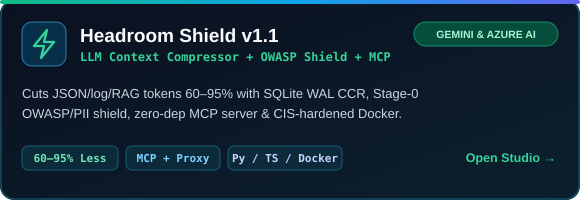
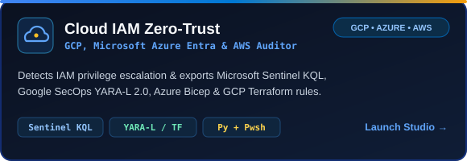
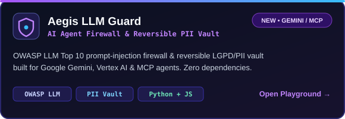
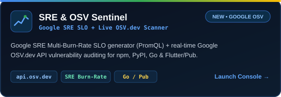

  
  
  
  
  
  
  
  

---

## 🚀 Principais Sistemas Open-Source (Segurança de IA, Multi-Cloud IAM & Google SRE)

> **Ferramentas 100% gratuitas, open-source e *Privacy-First* (nenhum dado sai do seu navegador — ideal para LGPD, SOC, Cloud Security e Big Tech).**

<table>
  <tr>
    <td width="50%" align="center">
      
       
      <a href="https://wallisonws.github.io/headroom-shield/"><b>Abrir Studio de Compressão</b></a> &nbsp;•&nbsp; <a href="https://github.com/WallisonWS/headroom-shield"><b>MCP Server, Gemini &amp; Azure AI</b></a>
    </td>
    <td width="50%" align="center">
      
       
      <a href="https://wallisonws.github.io/cloud-iam-zero-trust/"><b>Abrir Studio Multi-Cloud</b></a> &nbsp;•&nbsp; <a href="https://github.com/WallisonWS/cloud-iam-zero-trust"><b>Sentinel KQL, YARA-L &amp; IaC</b></a>
    </td>
  </tr>
  <tr>
    <td width="50%" align="center">
      
       
      <a href="https://wallisonws.github.io/aegis-llm-guard/"><b>Abrir Playground OWASP</b></a> &nbsp;•&nbsp; <a href="https://github.com/WallisonWS/aegis-llm-guard"><b>SDK Python &amp; JS</b></a>
    </td>
    <td width="50%" align="center">
      
       
      <a href="https://wallisonws.github.io/sre-osv-sentinel/"><b>Console OSV.dev &amp; SLO</b></a> &nbsp;•&nbsp; <a href="https://github.com/WallisonWS/sre-osv-sentinel"><b>CLI Zero-Deps</b></a>
    </td>
  </tr>
</table>

---

## 🧩 Catálogo Completo Open-Source (22 Web Apps Trilíngues Ao Vivo — PT-BR / EN / ES)

### 🛡️ Defesa Contra Ataques Hackers de IA, Sistemas LLM & AppSec
| Projeto | O Que Protege na Prática | App Online |
| :--- | :--- | :--- |
| **[headroom-shield](https://github.com/WallisonWS/headroom-shield)** | **Compressor de Contexto LLM Sem Dependências (60–95% menos tokens) + Escudo OWASP/PII**, CCR SQLite WAL, Servidor MCP, Docker CIS & pipelines **Google Gemini / Azure OpenAI**. | [Abrir →](https://wallisonws.github.io/headroom-shield/) |
| **[aegis-llm-guard](https://github.com/WallisonWS/aegis-llm-guard)** | Firewall **OWASP LLM Top 10** (Prompt Injection) + Cofre Reversível **LGPD/PII** para Gemini, Vertex AI e MCP. | [Abrir →](https://wallisonws.github.io/aegis-llm-guard/) |
| **[mcp-sentinel-firewall](https://github.com/WallisonWS/mcp-sentinel-firewall)** | Auditor Zero-Trust para agentes de código & servidores MCP: detecta *Tool-Poisoning*, *Rug-Pulls* (SHA-256) e SSRF. | [Abrir →](https://wallisonws.github.io/mcp-sentinel-firewall/) |
| **[rag-poison-guard](https://github.com/WallisonWS/rag-poison-guard)** | Sanitizador de bases RAG / Vector DB contra caracteres invisíveis Unicode (`U+E0000`), BiDi Trojans e vazamento via imagem Markdown. | [Abrir →](https://wallisonws.github.io/rag-poison-guard/) |
| **[ai-code-sec-scanner](https://github.com/WallisonWS/ai-code-sec-scanner)** | Scanner SAST multi-arquivo (22 regras CWE) para código gerado por IA (*Vibe-Coding*), com exportação **GitHub PR Markdown & SARIF v2.1.0**. | [Abrir →](https://wallisonws.github.io/ai-code-sec-scanner/) |
| **[slopsquat-guard](https://github.com/WallisonWS/slopsquat-guard)** | Defesa contra alucinação de pacotes por IA (*Slopsquatting*), typosquatting npm/PyPI e scripts maliciosos de `postinstall`. | [Abrir →](https://wallisonws.github.io/slopsquat-guard/) |
| **[deepfake-phish-shield](https://github.com/WallisonWS/deepfake-phish-shield)** | Detector de AI Phishing, domínios falsos Homograph/Punycode, typosquatting de marcas (Nubank, GitHub, Google) e SPF/DMARC. | [Abrir →](https://wallisonws.github.io/deepfake-phish-shield/) |
| **[ai-bot-defense](https://github.com/WallisonWS/ai-bot-defense)** | Defesa contra bots/fuzzers autônomos de IA: *Honeypot Traps*, Rate Limiter e regras prontas para Nginx, Cloudflare WAF, Fail2Ban e FastAPI. | [Abrir →](https://wallisonws.github.io/ai-bot-defense/) |

### ☁️ Multi-Cloud IAM (GCP / Azure / AWS), Google SRE & Infraestrutura Zero-Trust
| Projeto | O Que Entrega | App / Repo |
| :--- | :--- | :--- |
| **[cloud-iam-zero-trust](https://github.com/WallisonWS/cloud-iam-zero-trust)** | **Auditor IAM Multi-Cloud** (**Google Cloud GCP**, **Microsoft Azure Entra/RBAC** & **AWS**) com geração instantânea de **Microsoft Sentinel KQL**, **Google SecOps YARA-L 2.0**, **Azure Bicep** e **Terraform**. | [Abrir →](https://wallisonws.github.io/cloud-iam-zero-trust/) |
| **[sre-osv-sentinel](https://github.com/WallisonWS/sre-osv-sentinel)** | Motor **Google SRE Burn-Rate SLO** (`PromQL`) + scanner em tempo real na API oficial do Google **`api.osv.dev`**. | [Abrir →](https://wallisonws.github.io/sre-osv-sentinel/) |
| **[devsecops-toolkit](https://github.com/WallisonWS/devsecops-toolkit)** | **Suíte 18-em-1 Trilíngue (PT/EN/ES):** Firewall (FortiGate/MikroTik/pfSense/AWS), CIDR, SOC, CVSS 3.1, **Assinador JWT HS256**, **File SHA-256/Hex**, Custo IA, Git & **Kit Brasil (CPF/CNPJ/PIX EMV)**. | [Abrir →](https://wallisonws.github.io/devsecops-toolkit/) |
| **[passvault-audit](https://github.com/WallisonWS/passvault-audit)** | **Debugger 2FA TOTP Real (RFC 6238 ao vivo)**, Estimador de Tempo de Quebra em GPU H100 e Gerador Criptográfico Diceware. | [Abrir →](https://wallisonws.github.io/passvault-audit/) |
| **[k8s-zero-trust-lab](https://github.com/WallisonWS/k8s-zero-trust-lab)** | Gerador visual de **Kubernetes `NetworkPolicy`** + Auditor **CIS Pod Security** para GKE, AKS e EKS. | [Abrir →](https://wallisonws.github.io/k8s-zero-trust-lab/) |
| **[netguard-audit](https://github.com/WallisonWS/netguard-audit)** | Auditor TLS & HTTP Security Headers (Nota `A+` a `F`), scanner de segredos Git e relatório HTML executivo. | [Abrir →](https://wallisonws.github.io/netguard-audit/) |
| **[zero-leak-env](https://github.com/WallisonWS/zero-leak-env)** | Auditor de entropia `.env` + conversor para `.env.example`, Kubernetes `Secret` YAML (Base64) e `gh secret set`. | [Abrir →](https://wallisonws.github.io/zero-leak-env/) |
| **[awesome-secure-infrastructure](https://github.com/WallisonWS/awesome-secure-infrastructure)** | Arquitetura Zero Trust, Cheat Sheets CLI (FortiGate, Aruba, pfSense, AD) e Threat Intelligence Feed diário. | [Ver Repo →](https://github.com/WallisonWS/awesome-secure-infrastructure) |
| **[tactical-rmm-enhanced](https://github.com/WallisonWS/tactical-rmm-enhanced)** | Monorepo RMM Full-Stack (`Django` + `Vue 3` + `Go`) com telemetria em tempo real, EDR e diagnóstico com IA. | [Ver Repo →](https://github.com/WallisonWS/tactical-rmm-enhanced) |

### 🌍 Ferramentas para Devs, Designers, Analistas de Dados, Freelancers & Negócios
| Projeto | Público & Recursos | App Online |
| :--- | :--- | :--- |
| **[sql-sandbox-studio](https://github.com/WallisonWS/sql-sandbox-studio)** | **Motor SQL Real no Navegador:** Arraste qualquer CSV/JSON e rode queries `SELECT / WHERE / GROUP BY / SUM / AVG / ORDER BY` localmente em milissegundos. | [Abrir →](https://wallisonws.github.io/sql-sandbox-studio/) |
| **[git-ops-commander](https://github.com/WallisonWS/git-ops-commander)** | Assistente de emergências Git (`reflog`, limpar `.env` vazado, detached HEAD), `.gitignore` multi-stack e Conventional Commits. | [Abrir →](https://wallisonws.github.io/git-ops-commander/) |
| **[quickbox-tools](https://github.com/WallisonWS/quickbox-tools)** | **QR Code PIX Estático Oficial (Banco Central CRC16)**, Wi-Fi/WhatsApp QR, **Orçamento PDF**, **Simulador Dev na Gringa (USD/EUR → BRL PJ)**, Juros Compostos & Pomodoro. | [Abrir →](https://wallisonws.github.io/quickbox-tools/) |
| **[api-blueprint-studio](https://github.com/WallisonWS/api-blueprint-studio)** | JSON → **OpenAPI 3.1 YAML**, TypeScript **Zod**, Python **Pydantic v2**, Go Structs e assinatura **HMAC-SHA256** de Webhooks. | [Abrir →](https://wallisonws.github.io/api-blueprint-studio/) |
| **[pixelcraft-studio](https://github.com/WallisonWS/pixelcraft-studio)** | **Screenshots HD de Código** (estilo Ray.so), compressor WebP/PNG 100% local, CSS Glassmorphism e contraste WCAG. | [Abrir →](https://wallisonws.github.io/pixelcraft-studio/) |
| **[datasense-bi](https://github.com/WallisonWS/datasense-bi)** | **BI instantâneo no navegador** sem enviar planilhas: arraste CSV/JSON e ganhe KPIs, Tabela Dinâmica (Pivot) e gráficos. | [Abrir →](https://wallisonws.github.io/datasense-bi/) |
| **[markflow-studio](https://github.com/WallisonWS/markflow-studio)** | Editor Markdown split com templates prontos (**Currículo Tech ATS**, README, RFC) e exportação para **PDF limpo**. | [Abrir →](https://wallisonws.github.io/markflow-studio/) |

---

## 📊 Atividade no GitHub

  <picture>
    <source media="(prefers-color-scheme: dark)" srcset="https://raw.githubusercontent.com/WallisonWS/WallisonWS/output/github-contribution-grid-snake-dark.svg">
    <source media="(prefers-color-scheme: light)" srcset="https://raw.githubusercontent.com/WallisonWS/WallisonWS/output/github-contribution-grid-snake.svg">
    
  </picture>

---

  Aberto a oportunidades de alto impacto em <b>Análise de Sistemas, Segurança de IA, Cloud Security (GCP/Azure) &amp; SRE</b> (Brasil &amp; Remoto Internacional) • <a href="https://wallison-dev.vercel.app/">Portfólio</a> • <a href="https://www.linkedin.com/in/osintpaw/">LinkedIn</a> • <a href="mailto:wallisonoficial85@gmail.com">wallisonoficial85@gmail.com</a>

